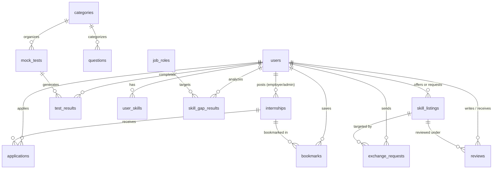

# 🚀 CareerBridge — Team Collaboration & DevOps Guide

> **Project Goal:** Build a unified campus career platform with 5 independently developed modules integrated seamlessly into one repository, one React frontend, one Flask backend, and one MySQL database.

---

## 👥 Module Ownership & Division of Responsibilities

| Member | Feature Branch | Backend Folder | Frontend Folder | Primary Responsibilities |
|---|---|---|---|---|
| **Member 1 (Team Lead)** | `feature/core-platform` | `app/auth/`<br>`app/common/` | `src/components/`<br>`src/pages/`<br>`src/context/` | Auth (JWT), Profile, Main Dashboard, Navigation, Common UI components, Integration & PR reviews |
| **Member 2** | `feature/internship` | `app/internship/` | `src/modules/internship/` | Available internships, search/filter, details, apply, status tracking, bookmarks |
| **Member 3** | `feature/placement` | `app/placement/` | `src/modules/placement/` | DSA prep, aptitude questions, technical interview prep, mock tests, scores & progress |
| **Member 4** | `feature/skill-gap` | `app/skill_gap/` | `src/modules/skillGap/` | Skill assessment, target job role selection, gap analysis, learning resource recommendations |
| **Member 5** | `feature/skill-exchange` | `app/skill_exchange/` | `src/modules/skillExchange/` | Peer skill offers/requests, student matching, request management, reviews & ratings |

---

## 🌳 Git & Branching Workflow (DevOps Requirement)

```
[main] ────────────────────────────────────────────────────────► Release
   │
   └──► [integration] ─────────────────────────────────────────► Staging
           │
           ├──► [feature/core-platform]  (Member 1) ──(PR)──► [integration]
           ├──► [feature/internship]     (Member 2) ──(PR)──► [integration]
           ├──► [feature/placement]      (Member 3) ──(PR)──► [integration]
           ├──► [feature/skill-gap]      (Member 4) ──(PR)──► [integration]
           └──► [feature/skill-exchange] (Member 5) ──(PR)──► [integration]
```

### Git Rules for All Members
1. **Never commit directly to `main` or `integration`**.
2. **Always start your work by branching off `integration`**:
   ```bash
   git checkout integration
   git pull origin integration
   git checkout -b feature/<your-module-name>
   ```
3. **Commit often with clear commit messages**:
   ```bash
   git add .
   git commit -m "feat(internship): add filter by location and stipend"
   ```
4. **Push to your feature branch**:
   ```bash
   git push -u origin feature/<your-module-name>
   ```
5. **Create a Pull Request (PR) on GitHub**:
   - Base branch: `integration`
   - Compare branch: `feature/<your-module-name>`
   - Tag **Member 1** for review.

---

## 🗄️ Unified Database Schema & ER Diagram

All modules connect back to the core `users` table created by Member 1.



### Seed Accounts for Instant Testing
| Role | Email | Password |
|---|---|---|
| **Student** | `student@careerbridge.com` | `student123` |
| **Admin** | `admin@careerbridge.com` | `admin123` |
| **Employer / Recruiter** | `recruiter@careerbridge.com` | `student123` |

---

## 📡 Standard API Response Format

All 5 backend modules must use the helpers from `app.common.utils`:

### 1. Success Response (HTTP 200 / 201)
```python
from app.common.utils import success_response

return success_response(
    data={"items": items, "total": len(items)},
    message="Items retrieved successfully",
    status=200
)
```
Output:
```json
{
  "success": true,
  "message": "Items retrieved successfully",
  "data": { ... }
}
```

### 2. Error Response (HTTP 400 / 401 / 404 / 500)
```python
from app.common.utils import error_response

return error_response("Resource not found", status=404)
```
Output:
```json
{
  "success": false,
  "message": "Resource not found"
}
```

### 3. Authenticated Routes (Extracting User ID)
```python
from flask_jwt_extended import jwt_required, get_jwt_identity

@your_bp.route('/my-items', methods=['GET'])
@jwt_required()
def get_my_items():
    user_id = int(get_jwt_identity())
    # Query database using user_id
```

---

## 🎨 Common Frontend Components (Provided by Member 1)

Members 2-5 can immediately import and use these shared components to maintain UI consistency:

```javascript
import Card from '../../components/common/Card';
import LoadingSpinner from '../../components/common/LoadingSpinner';
import Button from '../../components/common/Button';
import Alert from '../../components/common/Alert';
import Badge from '../../components/common/Badge';
import Modal from '../../components/common/Modal';
```

### Example Usage:
```jsx
<Card title="Available Internships" hoverable>
  <Badge color="green">Active</Badge>
  <Button variant="primary" size="sm" onClick={handleApply}>Apply Now</Button>
</Card>
```

---

## 🐳 Quick Start & Local Run

### Option A: Running with Docker (Recommended for Testing Integration)
```bash
# Starts MySQL, Flask Backend, and React Frontend simultaneously
docker-compose up --build
```
- Frontend: `http://localhost:5173`
- Backend API: `http://localhost:5000`
- MySQL: `localhost:3306`

### Option B: Running Locally

#### 1. Database:
Import `database/schema.sql` into your local MySQL server:
```bash
mysql -u root -p < database/schema.sql
```

#### 2. Backend:
```bash
cd backend
python -m venv venv
venv\Scripts\activate   # Windows
pip install -r requirements.txt
python run.py
```

#### 3. Frontend:
```bash
cd frontend
npm install
npm run dev
```

